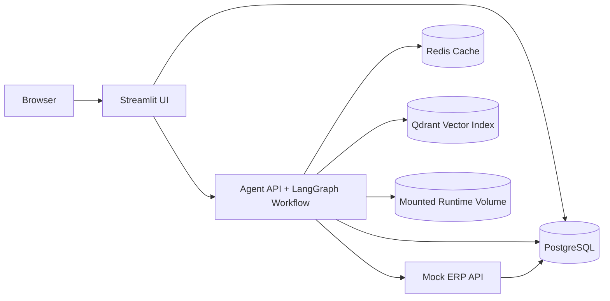

# AI Invoice Auditor - 5 Slide Presentation

## Slide 1 - Problem and Objective
- Global logistics company receives multilingual invoices in PDF, DOCX, and scanned-image formats.
- Manual auditing is slow, error-prone, and expensive.
- Goal: automate extraction, translation, ERP validation, discrepancy detection, reporting, RAG querying, and human review.
- Success criteria include durability, containerization, service boundaries, and reproducible startup.

## Slide 2 - Deployed Architecture

- 6 containers: `agent`, `mock-erp`, `streamlit-ui`, `postgres`, `qdrant`, `redis`
- Compose service-name networking only
- PostgreSQL is the system of record; Qdrant is derived; Redis is disposable

## Slide 3 - Invoice Processing Flow
- Monitor mounted drop folder and compute file checksum
- Skip duplicates by content checksum
- Extract raw text and structured fields from PDF, DOCX, or PNG
- Detect language and translate to English (cached)
- Run data validation and business validation through Mock ERP HTTP API
- Persist audit rows, line items, discrepancies, and recommendations
- Generate JSON + HTML reports
- Index persisted text and reports into Qdrant

## Slide 4 - RAG + Human-in-the-Loop
- Structured questions -> PostgreSQL via safe text-to-SQL path
- Open-ended questions -> retrieve -> rerank -> generate -> reflect (RAG Triad)
- Redis caches repeated LLM responses
- Streamlit dashboard lets auditors:
  - review reports and discrepancies
  - inspect raw/translated text
  - submit corrections
  - request revalidation
  - ask natural-language questions
- Human feedback is stored separately and never overwrites original extraction

## Slide 5 - Verification and Operations
- `docker compose up --build -d` starts the full stack
- Named volumes preserve PostgreSQL and Qdrant across `docker compose down`
- `docker compose down -v` deletes those volumes for deliberate data-loss testing
- Image history inspection confirms no `.env` or credentials are baked into images
- Health checks and `depends_on: condition: service_healthy` prevent premature startup
